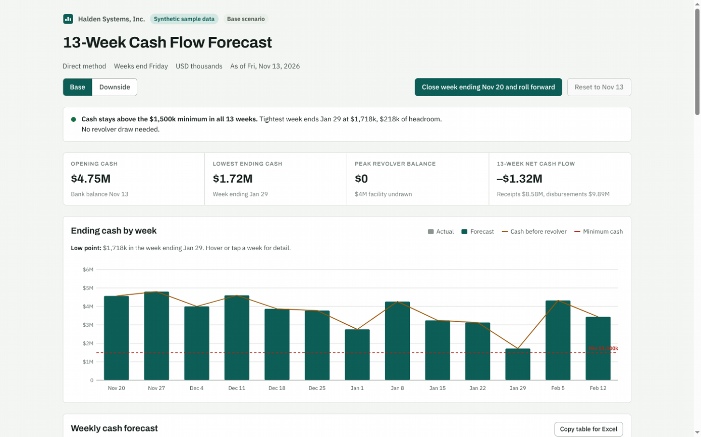

# 13-Week Cash Flow Forecast

A working treasury tool that builds a direct-method, rolling 13-week cash flow forecast for a mid-size B2B SaaS company, flags minimum-cash breaches, sizes revolver draws, and compares each closed week's bank actuals with the forecast.

Everything runs in the browser with no dependencies. All company, customer, vendor and bank data is synthetic.



**Live demo:** [salmaadan34-commits.github.io/13-week-cash-flow](https://salmaadan34-commits.github.io/13-week-cash-flow/)

---

## What it does

| Feature | What a reviewer sees |
| --- | --- |
| Weekly direct-method forecast | 13 weeks of receipts and disbursements by line, net cash flow, beginning and ending cash, with a 13-week total column |
| Minimum cash alert | A banner and chart line show the first week cash would fall below policy minimum, before and after financing |
| Revolver logic | Automatic draws and repayments in $250k steps, capped at the facility, with interest and availability shown each week |
| Scenarios | Base and Downside presets, plus five editable assumptions for custom what-ifs |
| Roll-forward | "Close week" loads that week's bank activity, freezes forecast vs actual, carries actual cash forward and adds a new week 13 |
| Variance analysis | Forecast vs actual by line with favourable/(unfavourable) amounts, % variance, review flags and plain-English explanations |
| Source data | Read-only AR aging, AP aging and fixed payment schedule, with the expected week for every invoice |
| Controls | Cash proof on every week, locked source data, frozen closed weeks and a time-stamped assumptions log |
| Excel hand-off | One click copies the forecast table as tab-separated values for Excel or Google Sheets |

## The sample company

**Halden Systems, Inc.** is a fictional B2B SaaS company with about 140 employees, as of Friday, November 13, 2026.

- Opening cash $4.75M, minimum cash policy $1.5M
- AR aging of $3.38M across 21 invoices, from current to 90+ days past due
- AP aging of $0.98M across 14 vendor invoices, one on hold for a billing dispute
- Monthly subscription billing on the 1st (January carries annual renewals) and weekly usage billing, all net 30
- Biweekly payroll of $835k, a $520k annual bonus in late January, rent, benefits, term loan payments, taxes and capex
- A $4.0M revolving credit facility at 7.25%, undrawn at the start

The CSV files in [`data/`](data/) contain the same sample data so it can be reviewed in Excel.

## How the forecast works

Weeks run Saturday to Friday ("week ending Friday"). All amounts are in USD thousands.

**Receipts**
- *Current AR* is expected on the invoice due date plus the slippage assumption, at the collection rate.
- *Past-due AR* is expected after a lag by aging bucket (0, 14, 28 or 49 days) plus slippage, at a lower rate for older buckets (95%, 85%, 60%, 25% at base). Bucket rates scale with the collection-rate assumption.
- *New billings* not yet invoiced are collected on billing date + 30 days + slippage, adjusted by the billings-vs-plan assumption.

**Disbursements**
- *AP aging* invoices are paid in the Thursday payment run of the week they fall due; past-due invoices are paid in week 1.
- *Vendor spend* not yet invoiced runs at a weekly rate and is paid net 30.
- *Payroll, bonus, benefits, rent, term loan, taxes and capex* follow a dated schedule.
- *Revolver interest* is charged weekly on the opening balance.

**Financing and liquidity**
1. Cash before financing = beginning cash + receipts − disbursements.
2. If that is below minimum cash, draw on the revolver in $250k steps until minimum is restored, up to the facility limit.
3. If cash exceeds minimum by more than $1.0M and the revolver is drawn, repay in $250k steps.
4. If the facility is fully drawn and cash is still below minimum, the page raises a liquidity-gap alert.

**Roll-forward**

Closing a week loads simulated bank activity for that week. Invoices that paid are cleared. Invoices that didn't pay are re-dated when the customer has confirmed a new date, or removed from the forecast for bad-debt review when there is no commitment. The forecast for the closed week is frozen next to the actuals, actual ending cash becomes the new opening balance, and the 13-week window moves forward one week. The sample bank feed covers six weeks.

## Assumptions

| Assumption | Base | Downside | What it moves |
| --- | --- | --- | --- |
| Collection rate, current AR | 98% | 93% | How much of each invoice is expected to collect |
| Collection slippage | 3 days | 14 days | How long after the due date customers pay |
| New billings vs plan | 0% | −8% | Subscription and usage invoices not yet issued |
| Payroll per cycle | $835k | $835k | Biweekly gross pay plus employer taxes |
| Minimum cash balance | $1,500k | $1,500k | Policy floor that triggers revolver draws |

In the base case cash bottoms out at about $1.72M in the week ending January 29, after the annual bonus and before January renewals collect. In the downside case renewals slip past week 13 and the revolver is needed for several weeks.

## Controls

Finance tools built quickly still need the controls a reviewer or auditor would expect:

- **Synthetic data only.** No real ledger or bank data is used.
- **Locked source data.** AR aging, AP aging and the payment schedule are read-only; only five labelled assumptions can change.
- **Assumptions log.** Every change, scenario switch, roll-forward and reset is time-stamped.
- **Cash proof.** Every week proves beginning cash + receipts − disbursements ± revolver = ending cash.
- **Frozen closed weeks.** Once a week is closed, its actuals and the forecast it is measured against can't be edited.
- **Documented liquidity rule.** Minimum cash, draw and repayment steps and the facility cap follow one written rule.
- **Automated tests.** `npm test` checks that every week ties, the revolver rule holds, and roll-forward never double-counts scheduled payments.

## Run it

Requires Node.js 18 or later. There are no packages to install.

```bash
npm run build     # bundles src/ into one self-contained file: dist/index.html
npm test          # runs the engine tests
npm run data      # regenerates the CSVs in data/ from the sample data
```

Open `dist/index.html` in any browser after building. To work on the source files directly, serve the folder (for example `npx serve .`) and open `index.html`.

The live demo is served by GitHub Pages straight from the repository root (`index.html` plus `src/`), so no build step is needed to publish.

## Project structure

```
13-week-cash-flow/
├── index.html            Development entry point (loads src/)
├── src/
│   ├── engine.js         Sample data, forecast, revolver and roll-forward logic
│   ├── app.js            Page rendering, chart, assumptions, variance and log
│   ├── body.html         Page markup
│   └── styles.css        Light and dark themes
├── data/                 Sample data as CSV
├── scripts/
│   ├── build.js          Bundles everything into dist/index.html
│   └── export-csv.js     Writes data/*.csv from the engine's sample data
├── tests/
│   └── engine.test.js    Node test runner tests
└── docs/                 Screenshot for this README
```

## Possible next steps

- Upload real AR and AP aging exports (CSV) in place of the sample data
- Weekly forecast snapshots, so accuracy can be tracked over several months
- Borrowing-base limits on the revolver
- Export of the forecast and variance pack to Excel

## Disclaimer

Portfolio project. Halden Systems and every customer, vendor and figure in this repository are fictional and for demonstration only.
